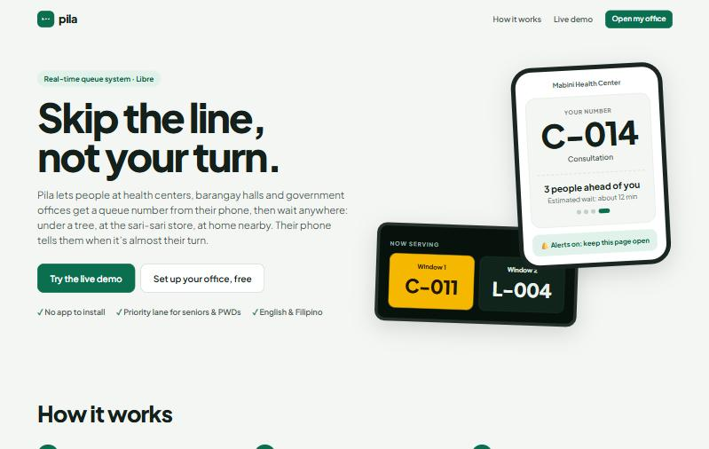
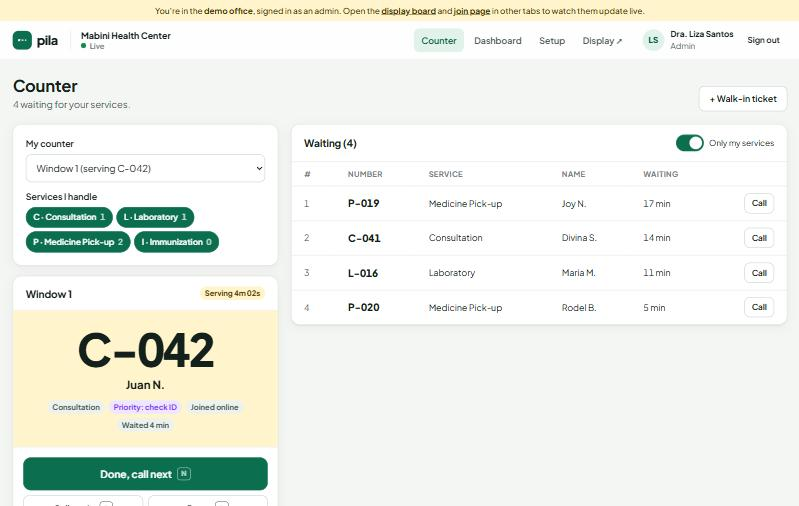
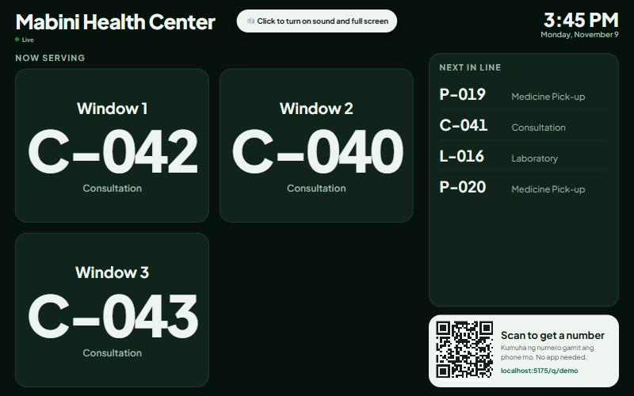
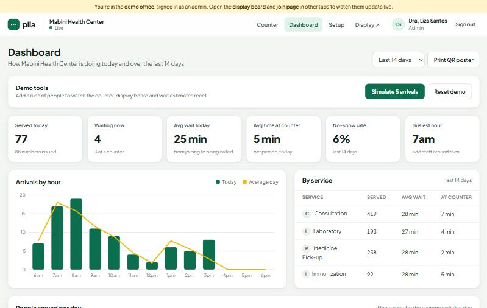
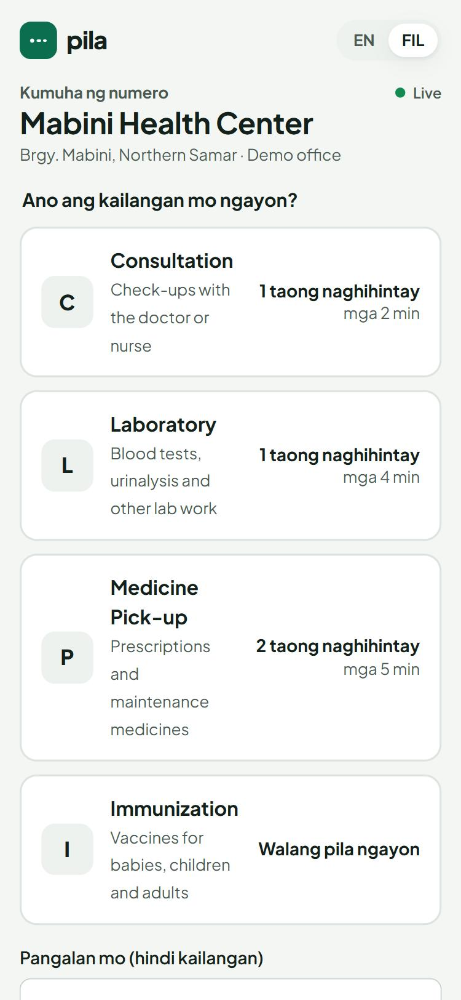

# Pila: skip the line, not your turn

**Pila** (Filipino for *"line"* or *"queue"*) is a real-time queue system for health centers, barangay halls and government offices. People scan a QR code at the entrance, get a number on their phone, and wait anywhere instead of standing in line for hours. Their phone shows their place in line and alerts them when it's almost their turn.

**Live demo: https://pila-5gjs.onrender.com** (free hosting: the first visit after a quiet spell takes ~30–60 seconds to wake up)

> React 19 + TypeScript · Node.js + Express · PostgreSQL · Socket.IO · Vitest · GitHub Actions



| Counter staff console | Waiting-room display board |
|---|---|
|  |  |

| Admin dashboard | Join page on a phone (Filipino) |
|---|---|
|  |  |

## Why

In many Philippine public offices, the queue *is* the waiting room: people arrive before opening, stand in one line for hours, and can't step away without losing their place. Pila keeps the order of the line but frees the people in it.

## What it does

**For the public** (no app, no account)
- Scan the QR poster → choose a service → get a number like **C-014**
- Live position and estimated wait, alerts when 2 people are ahead and when called
- **Priority lane** for senior citizens, PWDs and pregnant women
- English and Filipino

**For counter staff**
- One button (**N**): finish the current person and call the next
- Call again (**R**), done (**D**), no-show, or call someone out of order
- Walk-in tickets for people without phones
- Choose which counter you're at and which services you handle

**For the office**
- TV **display board** with a chime and spoken announcements ("Number C 14, please proceed to Window 2")
- **Dashboard**: served today, average wait, time at counter, no-show rate, busiest hour, arrivals by hour vs an average day
- Manage services, counters and staff accounts; open or pause online joining
- Printable bilingual QR poster

## Engineering highlights

These are the parts I'd point to in an interview:

- **No double-calls, even under concurrency.** "Call next" runs in a transaction with `SELECT … FOR UPDATE SKIP LOCKED`, so two counters pressing the button at the same instant always get different people. A partial unique index (`one serving ticket per counter`) makes the database itself enforce the rule. Both are covered by tests.
- **Atomic, per-day numbering.** Numbers come from `INSERT … ON CONFLICT DO UPDATE … RETURNING`, so 25 simultaneous joins get 25 distinct numbers (tested). Numbers reset at midnight **Manila time**, not UTC (also tested).
- **Wait estimates that learn.** Estimated wait = people ahead × average service time ÷ active counters, where the average comes from each service's last 30 completed tickets.
- **Real-time without drift.** After every change the server pushes a full snapshot over Socket.IO (bursts are coalesced into one push) instead of diffs, so a client that missed a message can't fall out of sync. The ticket page also polls as a fallback when WebSockets are blocked.
- **Privacy by design.** The public snapshot contains only ticket codes: no names and no ticket IDs (a test asserts this). A ticket's unguessable UUID works as its claim check.
- **Security basics.** bcrypt password hashes, JWT in an `httpOnly` `SameSite=Lax` cookie, role checks (admin vs staff), every query scoped to the user's own office (tested across offices), zod validation on every input, rate limits on sign-in and ticket creation, the same error for a wrong email or a wrong password, and security headers.
- **One codebase, two databases.** Production uses PostgreSQL. Local dev and tests use **PGlite** (real Postgres compiled to WebAssembly), so `npm install && npm run dev` works without installing a database, and every test gets a fresh in-memory database.
- **Versioned migrations**, shared TypeScript types between server and client, and hand-built SVG charts (no chart library).
- **Realistic demo data.** The demo office's two weeks of history come from a small simulation: people arrive on a curve, many before the 8 AM opening, and three windows serve them first come, first served. So the wait times and charts behave like a real health center's.

## Architecture

```
 Phone (join + ticket)   Staff console   Display board (TV)   Admin dashboard
        │                     │                 │                    │
        └──────── HTTPS (REST) + WebSocket (Socket.IO) ─────────────┘
                                   │
                    Node.js · Express 5 · Socket.IO
          auth (JWT cookie) · zod validation · rate limits
          queue engine (transactions, row locks) · analytics
                                   │
                       PostgreSQL  (PGlite in dev/tests)
```

One server serves the API, the WebSocket and the built React app, so it deploys as a single service.

## Run it locally

Requires Node.js 20 or newer. No database to install.

```bash
npm install
npm run dev
```

Open http://localhost:5175. The API runs on port 3001, and Vite proxies `/api` and `/socket.io` to it. On first start the server creates the demo office with two weeks of history. Use **Demo: counter staff** or **Demo: office admin** on the sign-in page, or sign in with `staff@pila.demo` / `admin@pila.demo` (password `demo1234`).

To see the real-time part, open the staff console, the display board (`/display/demo`) and the join page (`/q/demo`) in three tabs.

| Command | What it does |
|---|---|
| `npm run dev` | API + web app with hot reload |
| `npm test` | 30 tests (queue engine + HTTP API) against a fresh in-memory Postgres |
| `npm run typecheck` | TypeScript, client and server |
| `npm run build` | Production build into `dist/` |
| `npm start` | Run the production build |

Settings live in `.env` (see [`.env.example`](.env.example)). All are optional in development.

## Deploy (free)

1. Create a free Postgres database on [Neon](https://neon.tech) and copy its connection string.
2. On [Render](https://render.com), choose **New → Blueprint** and pick this repo. [`render.yaml`](render.yaml) sets up the web service and generates `JWT_SECRET`.
3. Paste the Neon connection string as `DATABASE_URL`.

Render's free tier supports WebSockets. It sleeps when idle, so the first visit after a while takes ~30 seconds. Vercel's serverless functions can't hold WebSocket connections, which is why Pila isn't on Vercel.

## Project structure

```
server/
  index.ts          start-up, hourly housekeeping
  app.ts            Express app (createApp is used by tests too)
  queue.ts          queue engine: tickets, calling, estimates, snapshots
  analytics.ts      dashboard numbers
  realtime.ts       Socket.IO rooms and coalesced pushes
  auth.ts           passwords, sessions, role checks
  seed.ts           demo office + day simulation
  db/               Postgres/PGlite driver and migrations
  routes/           auth, public, staff, admin
client/src/
  pages/            Landing, Join, Ticket, Display, Auth, staff/Console, admin/*
  components/       UI pieces, hand-drawn BarChart
  lib/              api client, socket hooks, i18n, sounds
shared/types.ts     types shared by server and client
tests/              Vitest + Supertest
```

## What I'd add next

- SMS alerts (e.g. via Semaphore) for people with basic phones
- Transferring a ticket to another service (consultation → laboratory)
- Usability testing with staff at a real health center
- Multiple office branches under one account

---

Built by **Dran Magdaraog** · IT student, Northern Samar, Philippines
